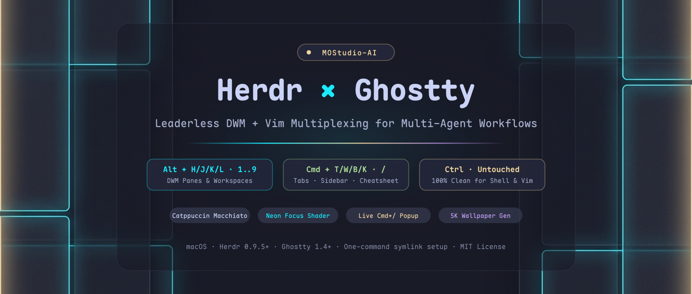
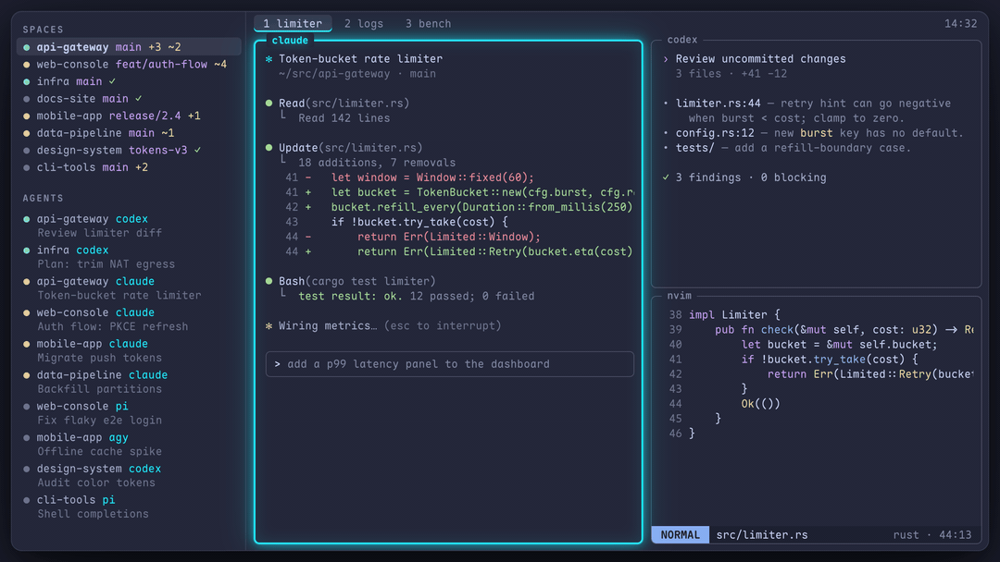
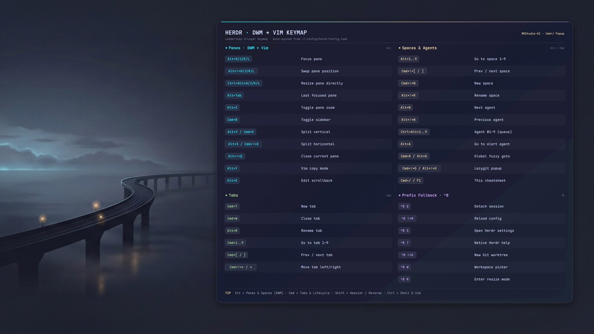

<div align="center">



# herdr-ghostty-kit

**Ditch the `Ctrl+b` prefix key.** A battle-tested macOS terminal workspace configuration for [Herdr](https://herdr.dev) and [Ghostty](https://ghostty.org), built for engineers running 10–20 concurrent AI coding agents (`Claude Code`, `Codex`, `Antigravity CLI`, `Pi`) alongside Neovim and Zsh.

[](https://www.apple.com/macos/)
[](https://herdr.dev)
[](https://ghostty.org)
[](LICENSE)

**English** · [简体中文](README.zh-CN.md)

</div>

---

## Showcase

<div align="center">
  
  <p><em>Pane navigation with electric-cyan neon focus bloom · Instant multi-agent triage · Live <code>Cmd+/</code> cheatsheet popup · Auto-synced 5K wallpaper</em></p>
  <p>🎬 <a href="media/promo.mp4">Watch full 1080p promo video (<code>media/promo.mp4</code>)</a></p>
</div>

---

## Why This Setup?

Traditional multiplexers force a modal prefix chord (`Ctrl+b`, release, then key) that breaks flow, collides with IME input, and slows down multi-agent triage. If you come from Linux **DWM** and **Vim**, you want a single dedicated modifier layer—without breaking Zsh, Neovim, or CLI coding agents.

| Pain Point | How This Kit Solves It |
| :--- | :--- |
| **`Ctrl+b` leader fatigue & IME friction** | **3-layer modifier isolation**: `Alt` = DWM panes/workspaces, `Cmd` = browser-native tabs/sidebar, `Ctrl` = 100% untouched for Shell & Vim. `Ctrl+b` stays only as an SSH fallback. |
| **Hidden shortcut collisions** | Audited against **Zsh (`bindkey`)**, **LazyVim/Neovim**, **Ghostty defaults**, and **Claude Code** (`Alt+B` left for backward-word, `Alt+P` for model picker, `Alt+O` for fast mode, `Cmd+E` for Neo-tree, `Alt+Shift+Q` prevents accidentally killing a running agent). |
| **Hard-to-spot focused split pane** | Custom Metal/GLSL **selective neon focus-glow shader** ([`herdr-focus-glow.glsl`](ghostty/shaders/herdr-focus-glow.glsl)) tuned to Catppuccin Macchiato (`#24273a`) and optimized from **~201 → ~57 texture fetches/px** (~72% less GPU cost during continuous agent spinners). |
| **Forgetting new keybindings** | Press **`Cmd+/`** (or **`F1`**) anytime for a **live 3-column TUI cheatsheet popup** parsed straight from `config.toml` with `/` instant filter—plus a **dual-display 5K/Retina desktop wallpaper generator** built from the exact same source of truth. |
| **Messy config drift** | Idempotent file-level symlink manager ([`link.sh`](link.sh)) with `--dry-run`, `--check` (detects broken or overwritten symlinks), and machine-local Ghostty path generation—zero hardcoded usernames. |

---

## Quick Start

### Prerequisites (macOS)

- [Herdr](https://herdr.dev) `0.9.5+`
- [Ghostty](https://ghostty.org) `1.4+`
- [Maple Mono NF CN](https://github.com/subframe7536/maple-font) (or edit `font-family` in [`ghostty/config`](ghostty/config))
- Optional: `lazygit` (for `Cmd+Shift+G` popup), `imagemagick` + `librsvg` (`brew install imagemagick librsvg`) if you want to re-render the desktop cheat-sheet wallpapers

### Install via Symlinks

```bash
git clone https://github.com/MOStudio-AI/herdr-ghostty-kit.git
cd herdr-ghostty-kit

# 1. Preview what will be backed up and linked (no changes made)
./link.sh --dry-run

# 2. Apply file-level symlinks (existing files are backed up with timestamps)
./link.sh

# 3. Verify symlinks and machine-local Ghostty path config
./link.sh --check

# 4. Validate and hot-reload Herdr
herdr config check
herdr server reload-config
ghostty +validate-config
```

Finally, press **`Cmd+Shift+,`** inside Ghostty to reload (reopen the window once if shader or font-weight changes need a fresh surface), then press **`Cmd+/`** to open your live cheatsheet!

---

## Keybinding Architecture

### The 3-Layer Mental Model

> **4-line mnemonic:** `Alt` = Panes & Spaces (DWM) · `Cmd` = Tabs & Lifecycle · `Shift` = Heavier / Reverse · `Ctrl` = Shell & Vim

| Layer | Role | Explicitly Preserved For Other Tools |
| :--- | :--- | :--- |
| **`Ctrl`** | Shell, Neovim/LazyVim, CLI Agents | `Ctrl+H/J/K/L`, `Ctrl+P`, `Ctrl+R`, `Ctrl+W`, `Ctrl+A/E`, `Ctrl+C/D/Z` |
| **`Alt` (`Option`)** | DWM-style spatial pane, workspace & agent dispatch (`macos-option-as-alt = true`) | `Alt+B` (backward-word), `Alt+P` (Claude model picker), `Alt+O` (Claude fast mode), `Alt+/` (Zsh completion), `Alt+Enter` (agent newline) |
| **`Cmd` (`Super`)** | macOS tab lifecycle, sidebar toggle, global goto, cheatsheet | `Cmd+C/V/Q/H/M/Tab/Space` (macOS), `Cmd+E` (Neovim Explorer), `Cmd+=/−/0/,` (Ghostty) |
| **`Ctrl+b` (Prefix)** | Low-frequency actions & SSH fallback | Every core direct key keeps its `prefix+*` array fallback |

### Complete Keymap Reference

<details open>
<summary><strong>Panes — DWM + Vim (<code>Alt</code>)</strong></summary>

| Shortcut | Fallback | Action |
| :--- | :--- | :--- |
| `Alt + H / J / K / L` | `^B h/j/k/l` | Focus pane left / down / up / right |
| `Alt + Shift + H / J / K / L` | — | Swap pane position |
| `Ctrl + Alt + H / J / K / L` | — | Resize pane directly (no resize mode) |
| `Alt + Tab` | — | Jump to last focused pane (cross-workspace) |
| `Alt + Z` | `^B z` | Toggle pane zoom (`[ZOOM]` in tab bar) |
| `Cmd + B` | `^B b` | Toggle compact status sidebar |
| `Alt + V` / `Cmd + D` | `^B v` | Split vertical (side-by-side) |
| `Alt + S` / `Cmd + Shift + D` | `^B -` | Split horizontal (top/bottom) |
| `Alt + Shift + Q` | `^B x` | Close current pane (`Shift` prevents accidental agent kill) |
| `Alt + Y` | — | Enter Vim copy / scrollback mode |
| `Alt + E` | `^B e` | Open full scrollback in `$EDITOR` (Neovim) |

</details>

<details open>
<summary><strong>Workspaces, Multi-Agent Triage & Popups</strong></summary>

| Shortcut | Fallback | Action |
| :--- | :--- | :--- |
| `Alt + 1..9` | — | Go to workspace 1–9 (DWM tags) |
| `Cmd + Shift + [` / `]` | — | Previous / next workspace |
| `Cmd + Shift + N` | `^B N` | New workspace |
| `Alt + Shift + R` | `^B W` | Rename current workspace |
| `Alt + N` / `Alt + Shift + N` | — | Next / previous agent (priority order) |
| `Ctrl + Alt + 1..9` | — | Jump directly to agent #1–9 in priority queue |
| `Alt + A` | `^B o` | Jump straight to latest notified / `blocked` agent |
| `Cmd + K` / `Alt + G` | `^B g` | Global fuzzy goto (workspaces / tabs / panes / agents) |
| `Cmd + Shift + G` / `Alt + Shift + G` | `^B d` | Open `lazygit` popup in active pane's CWD |
| `Cmd + /` / `F1` | — | Open live 3-column keybindings cheatsheet popup |

</details>

<details>
<summary><strong>Tabs (<code>Cmd</code>) & Low-Frequency Prefix Fallbacks (<code>Ctrl+b</code>)</strong></summary>

| Shortcut | Fallback | Action |
| :--- | :--- | :--- |
| `Cmd + T` | `^B c` | New tab |
| `Cmd + W` | `^B X` | Close tab |
| `Alt + R` | `^B T` | Rename tab |
| `Cmd + 1..9` | `^B 1..9` | Go to tab 1–9 |
| `Cmd + [` / `]` | `^B p` / `^B n` | Previous / next tab |
| `Cmd + Shift + ←` / `→` | — | Reorder tab left / right |
| `^B q` / `^B R` / `^B s` / `^B ?` | — | Detach session / reload config / settings / native help |
| `^B G` / `^B w` / `^B r` | — | New Git worktree / workspace picker / resize mode |

</details>

---

## Featured Components

### 1. Live `Cmd+/` Cheatsheet Popup ([`herdr/cheatsheet.py`](herdr/cheatsheet.py))
- **Single Source of Truth**: Parses your live `~/.config/herdr/config.toml` (including `[[keys.command]]` popups) and backfills unmodified defaults from `herdr --default-config`.
- **Zero external Python dependencies**: Uses stdlib `tomllib` on Python 3.11+ with a built-in fallback parser for system Python 3.9.
- **Responsive TUI**: Adapts cleanly across 3-column / 2-column / 1-column layouts, supports **`/` live fuzzy search**, **`r` hot reload**, and **`q` / `Esc` / `Enter`** instant close.

### 2. Auto-Synced 5K & Retina Desktop Cheatsheet Wallpapers ([`wallpaper/build-wallpaper.py`](wallpaper/build-wallpaper.py))
Instead of cluttering your translucent terminal background with unreadable small text—or letting an image model misspell keycaps—this kit pairs a **text-free dark atmospheric base artwork** ([`wallpaper/base-bg.jpg`](wallpaper/base-bg.jpg), also linked as Ghostty's subtle terminal backdrop) with **deterministic SVG vector rendering** (`Maple Mono NF CN` + `rsvg-convert` + ImageMagick):

<div align="center">
  
</div>

Edit any shortcut in `herdr/config.toml`, then run one command to regenerate both native resolutions (with macOS menu-bar / notch / Dock safe margins):

```bash
python3 wallpaper/build-wallpaper.py
# Outputs:
#   wallpaper/out/herdr-cheatsheet-5k-16x9.png      (4608×2592, 16:9 External 5K)
#   wallpaper/out/herdr-cheatsheet-macbook-3x2.png  (3024×1964, 3:2 Built-in Retina)
```

### 3. Optimized Selective Neon Focus-Glow Shader ([`ghostty/shaders/herdr-focus-glow.glsl`](ghostty/shaders/herdr-focus-glow.glsl))
- Selectively adds a crisp cyan aura around Herdr's `#18ecff` focused border over Catppuccin Macchiato (`#24273a`) without blurring regular terminal text.
- Uses half-pixel bilinear 2px-stride sampling (**~57 fetches/px vs ~201 naive**), cutting GPU usage by ~72% while keeping 1px borders gap-free.

### 4. Repository Structure & Symlink Safety

```text
.
├── herdr/
│   ├── config.toml                       # Catppuccin Macchiato theme, compact sidebar, leaderless keymap
│   └── cheatsheet.py                     # Live 3-column TUI cheatsheet popup (Cmd+/ or F1)
├── ghostty/
│   ├── config                            # Ghostty unbinds, Macchiato theme, borderless window (portable)
│   └── shaders/herdr-focus-glow.glsl     # Optimized selective neon focus bloom Metal/GLSL shader
├── wallpaper/
│   ├── base-bg.jpg                       # Text-free twilight viaduct artwork (desktop & terminal backdrop)
│   └── build-wallpaper.py                # Dual-display 5K + MacBook Retina wallpaper compositor
├── media/
│   ├── hero-banner.png                   # Repository hero banner
│   ├── demo.gif                          # Homepage showcase animation
│   ├── promo.mp4                         # Full 1080p promotional video
│   ├── wallpaper-preview.jpg             # Preview of generated 5K cheatsheet wallpaper
│   ├── promo.html                        # Frame-accurate HTML scene source for promo/GIF
│   └── render-promo.mjs                  # Reproducible Headless Chrome + ffmpeg renderer
├── link.sh                               # Idempotent file-level symlink manager & health checker
├── README.md                             # English documentation (default)
├── README.zh-CN.md                       # Chinese documentation
└── LICENSE                               # MIT License
```

> **Why file-level symlinks?** `~/.config/herdr/` stores runtime sockets (`herdr.sock`), logs, and `session-snapshots/`. `./link.sh` links **only config files**, never the directory, and `./link.sh --check` detects if any tool (such as `sed -i`) accidentally replaced a symlink with a regular file. Ghostty's machine-specific absolute paths are isolated into an untracked `~/.config/ghostty/local-paths.conf` loaded via `config-file = ?local-paths.conf`.

---

## Troubleshooting & Notes

- **Raycast / Window Managers**: If `Ctrl+Alt+H/J/K/L` or `Ctrl+Alt+1..9` are intercepted on macOS, check whether Raycast / Rectangle / Magnet has global window bindings on `Ctrl+Opt+*`.
- **Chinese / CJK IME**: `herdr/config.toml` enables `reveal_hidden_cursor_for_cjk_ime = true` for `["claude", "codex", "pi"]` and `switch_ascii_input_source_in_prefix = true` so macOS candidate windows track cleanly.
- **LazyVim `Alt+J/K` line-move**: Since `Alt+J/K` are dedicated to Herdr pane focus, consider remapping Visual-mode `J`/`K` in Neovim (`:m '>+1<CR>gv=gv` and `:m '<-2<CR>gv=gv`).
- **Optional `herdr.auto-title` plugin**: If you install [herdr-auto-title](https://github.com/kryptamine/herdr-auto-title), add `[{ token = "$topic", bold = true, dim = false }]` as a second row under `[ui.sidebar.spaces]`.

---

## License

Released under the [MIT License](LICENSE) © 2026 **MOStudio-AI**.
