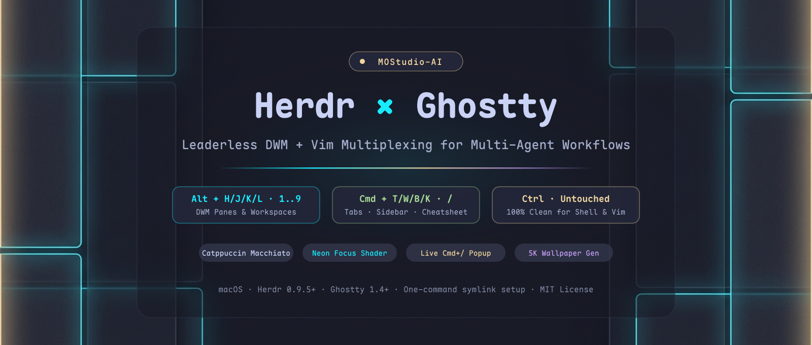
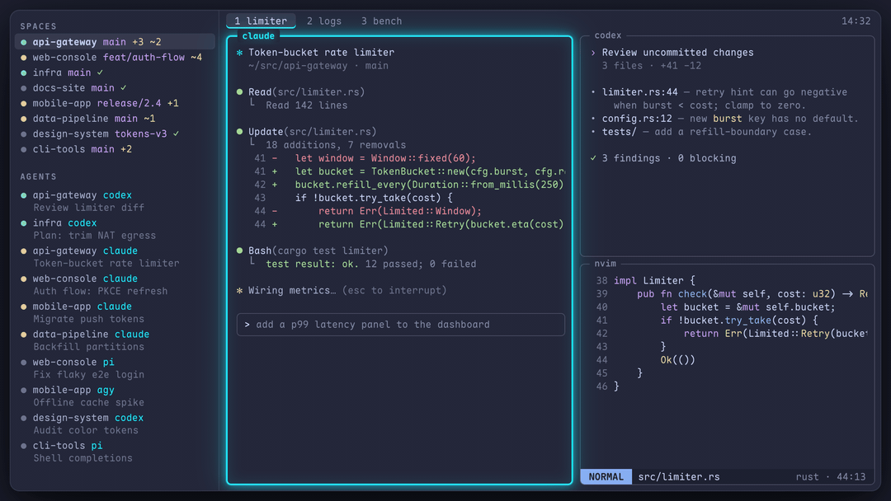
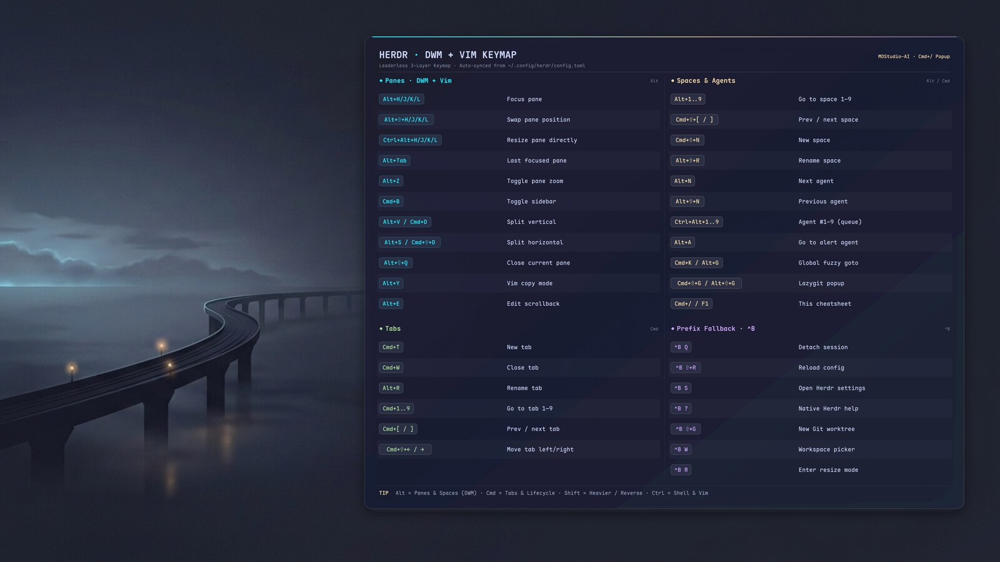

<div align="center">



# herdr-ghostty-kit

**彻底告别 `Ctrl+b` 前缀键。** 一套为 macOS 上 [Herdr](https://herdr.dev) 与 [Ghostty](https://ghostty.org) 深度打磨的终端复用配置方案，专为同时驱动 10–20 个 AI Coding Agent（`Claude Code`、`Codex`、`Antigravity CLI`、`Pi`）并重度使用 Neovim / Zsh 的工程师设计。

[](https://www.apple.com/macos/)
[](https://herdr.dev)
[](https://ghostty.org)
[](LICENSE)

[English](README.md) · **简体中文**

</div>

---

## 效果演示

<div align="center">
  
  <p><em>电光青聚焦边框泛光切换 · 多 Agent 极速巡检 · <code>Cmd+/</code> 实时三栏速查浮窗 · 自动同步 5K 桌面速查壁纸</em></p>
  <p>🎬 <a href="media/promo.mp4">观看完整 1080p 宣传视频（<code>media/promo.mp4</code>）</a></p>
</div>

---

## 为什么做这套配置？

传统的 tmux 风格前缀键（先按 `Ctrl+b`，松开再按命令键）节奏割裂、容易卡中文输入法，在多 Agent 并发巡检时尤其拖后腿。如果你习惯 Linux 下的 **DWM** 平铺窗口管理器和 **Vim** 手感，真正顺手的方式是**按修饰键彻底分层**——既能单次直达，又不跟 Shell、Neovim 和 Coding Agent 打架。

| 痛点 | 本套件的解法 |
| :--- | :--- |
| **`Ctrl+b` 前缀键累手、卡输入法** | **三层修饰键隔离**：`Alt` = DWM 窗格与空间调度、`Cmd` = macOS 浏览器直觉 Tab 与侧栏、`Ctrl` = 100% 留给 Shell 与 Vim；`Ctrl+b` 退居二线仅作 SSH 兜底。 |
| **隐蔽快捷键冲突** | 逐项核查 **Zsh（`bindkey`）**、**LazyVim/Neovim**、**Ghostty 默认键位** 与 **Claude Code**（让出 `Alt+B` 向后跳词、`Alt+P` 切模型、`Alt+O` 快速模式、`Cmd+E` Neo-tree；关窗格用 `Alt+Shift+Q` 防误杀正在跑的 Agent）。 |
| **多分屏找不到当前焦点** | 定制 Metal/GLSL **定向青色泛光着色器**（[`herdr-focus-glow.glsl`](ghostty/shaders/herdr-focus-glow.glsl)），精确对齐 Catppuccin Macchiato（`#24273a`），并通过半像素双线性 2px 步长把采样开销从 **~201 降至 ~57 次/像素**（降耗约 72%）。 |
| **新快捷键一时记不住** | 随时按 **`Cmd+/`**（或 **`F1`**）弹出**实时读取 `config.toml` 的三栏彩色英文速查浮窗**（支持 `/` 实时过滤），并配套**同源双屏 5K/Retina 桌面速查壁纸生成器**，改键一行命令同步刷新。 |
| **多处配置散落、路径写死** | 幂等文件级软链接脚本（[`link.sh`](link.sh)）自带 `--dry-run` 与 `--check`（精准识别断链或被普通文件覆盖），并通过 `local-paths.conf` 自动生成本机 `$HOME` 路径，零个人路径硬编码。 |

---

## 快速上手

### 环境要求（macOS）

- [Herdr](https://herdr.dev) `0.9.5+`
- [Ghostty](https://ghostty.org) `1.4+`
- [Maple Mono NF CN](https://github.com/subframe7536/maple-font) 字体（或自行修改 [`ghostty/config`](ghostty/config) 中的 `font-family`）
- 可选：`lazygit`（供 `Cmd+Shift+G` 浮窗使用）；如需重新渲染桌面速查壁纸，安装 `brew install imagemagick librsvg`

### 一键软链接安装

```bash
git clone https://github.com/MOStudio-AI/herdr-ghostty-kit.git
cd herdr-ghostty-kit

# 1. 预览备份与软链接操作（不改动磁盘）
./link.sh --dry-run

# 2. 正式建立文件级软链接（原文件自动带时间戳备份）
./link.sh

# 3. 巡检软链接与本机 Ghostty 路径配置
./link.sh --check

# 4. 校验并热重载 Herdr
herdr config check
herdr server reload-config
ghostty +validate-config
```

最后在 Ghostty 中按 **`Cmd+Shift+,`** 重载配置（首次加载 shader 或改字重建议重开一个窗口），然后直接按 **`Cmd+/`** 即可呼出你的实时快捷键速查浮窗。

---

## 键位体系设计

### 三层修饰键心智模型

> **四句口诀**：`Alt` = 窗格/空间（DWM） · `Cmd` = Tab/生命周期 · `Shift` = 重/反向/防误触 · `Ctrl` = 留给 Shell & Vim

| 修饰键层 | 职责定位 | 刻意避让的对象 |
| :--- | :--- | :--- |
| **`Ctrl`** | 100% 留给 Shell、Neovim/LazyVim 与 Agent | `Ctrl+H/J/K/L`、`Ctrl+P`、`Ctrl+R`、`Ctrl+W`、`Ctrl+A/E`、`Ctrl+C/D/Z` |
| **`Alt`（`Option`）** | DWM 风格窗格、工作区与 Agent 调度（`macos-option-as-alt = true`） | `Alt+B`（向后跳词）、`Alt+P`（Claude 切模型）、`Alt+O`（Claude 快速模式）、`Alt+/`（Zsh 补全）、`Alt+Enter`（Agent 换行） |
| **`Cmd`（`Super`）** | macOS 习惯的 Tab、侧边栏、全局跳转与速查 | `Cmd+C/V/Q/H/M/Tab/Space`（系统）、`Cmd+E`（Neovim 文件树）、`Cmd+=/−/0/,`（Ghostty） |
| **`Ctrl+b`（Prefix）** | 低频设置与 SSH / 异构终端兜底 | 高频动作全部写成数组保留 `prefix+*` 退路 |

### 完整键位速查表

<details open>
<summary><strong>窗格控制 · DWM + Vim（<code>Alt</code>）</strong></summary>

| 快捷键 | 兜底键 | 功能 |
| :--- | :--- | :--- |
| `Alt + H / J / K / L` | `^B h/j/k/l` | 左 / 下 / 上 / 右切换窗格焦点 |
| `Alt + Shift + H / J / K / L` | — | 交换相邻窗格位置 |
| `Ctrl + Alt + H / J / K / L` | — | 直接调整窗格尺寸（无需进入 resize 模式） |
| `Alt + Tab` | — | 跨工作区秒切最近聚焦窗格 |
| `Alt + Z` | `^B z` | 单窗格最大化切换（顶栏显示 `[ZOOM]`） |
| `Cmd + B` | `^B b` | 展开 / 收起紧凑状态灯侧边栏 |
| `Alt + V` / `Cmd + D` | `^B v` | 左右分屏（垂直分割） |
| `Alt + S` / `Cmd + Shift + D` | `^B -` | 上下分屏（水平分割） |
| `Alt + Shift + Q` | `^B x` | 关闭当前窗格（加 `Shift` 防止误杀 Agent） |
| `Alt + Y` | — | 进入 Vim 复制 / 翻页模式 |
| `Alt + E` | `^B e` | 用 `$EDITOR`（Neovim）打开完整滚动历史 |

</details>

<details open>
<summary><strong>工作区、多 Agent 调度与浮窗</strong></summary>

| 快捷键 | 兜底键 | 功能 |
| :--- | :--- | :--- |
| `Alt + 1..9` | — | 直达第 1–9 个工作区（DWM Tag 体验） |
| `Cmd + Shift + [` / `]` | — | 上一个 / 下一个工作区 |
| `Cmd + Shift + N` | `^B N` | 新建工作区 |
| `Alt + Shift + R` | `^B W` | 重命名当前工作区 |
| `Alt + N` / `Alt + Shift + N` | — | 按优先级队列切换下 / 上一个 Agent |
| `Ctrl + Alt + 1..9` | — | 直跳优先级队列第 1–9 个 Agent |
| `Alt + A` | `^B o` | 一键直达刚完成或 `blocked` 等待确认的 Agent |
| `Cmd + K` / `Alt + G` | `^B g` | 全局模糊跳转（工作区 / Tab / 窗格 / Agent） |
| `Cmd + Shift + G` / `Alt + Shift + G` | `^B d` | 在当前窗格目录弹出 `lazygit` 浮窗 |
| `Cmd + /` / `F1` | — | 呼出实时三栏快捷键速查浮窗 |

</details>

<details>
<summary><strong>Tab 标签页（<code>Cmd</code>）与低频兜底（<code>Ctrl+b</code>）</strong></summary>

| 快捷键 | 兜底键 | 功能 |
| :--- | :--- | :--- |
| `Cmd + T` | `^B c` | 新建 Tab |
| `Cmd + W` | `^B X` | 关闭 Tab |
| `Alt + R` | `^B T` | 重命名 Tab |
| `Cmd + 1..9` | `^B 1..9` | 直达第 1–9 个 Tab |
| `Cmd + [` / `]` | `^B p` / `^B n` | 上一个 / 下一个 Tab |
| `Cmd + Shift + ←` / `→` | — | 左 / 右调整 Tab 顺序 |
| `^B q` / `^B R` / `^B s` / `^B ?` | — | 分离会话 / 热重载配置 / 设置 / 原生帮助 |
| `^B G` / `^B w` / `^B r` | — | 新建 Git Worktree / 工作区面板 / 尺寸模式 |

</details>

---

## 核心特性拆解

### 1. `Cmd+/` 实时三栏速查浮窗（[`herdr/cheatsheet.py`](herdr/cheatsheet.py)）
- **单一数据源**：直接解析 `~/.config/herdr/config.toml`（含自定义 `[[keys.command]]` 浮窗），并从 `herdr --default-config` 自动补全未覆盖的默认兜底键，改键即同步；界面为全英文排版。
- **零外部依赖**：Python 3.11+ 直接用标准库 `tomllib`，同时内置轻量解析器兜底兼容系统自带 Python 3.9。
- **终端原生交互**：随窗宽自适应 3 栏 / 2 栏 / 1 栏排版，支持 **`/` 实时模糊筛选**、**`r` 重读配置**、**`q` / `Esc` / `Enter`** 秒关。

### 2. 自动同步的 5K / Retina 桌面速查壁纸（[`wallpaper/build-wallpaper.py`](wallpaper/build-wallpaper.py)）
为了既不干扰终端阅读，又避免 AI 直接画字导致的错字和难维护问题，本方案采用**「无文字暗色氛围底图（[`wallpaper/base-bg.jpg`](wallpaper/base-bg.jpg)，同时作为 Ghostty 终端低透明背景）+ 矢量精准排版」**（`Maple Mono NF CN` + `rsvg-convert` + ImageMagick）：

<div align="center">
  
</div>

以后在 `herdr/config.toml` 改完任意键位，执行一行命令即可重新合成两块屏的原生分辨率壁纸（已预留 macOS 菜单栏、刘海与 Dock 安全边距）：

```bash
python3 wallpaper/build-wallpaper.py
# 生成产物：
#   wallpaper/out/herdr-cheatsheet-5k-16x9.png      （4608×2592，外接 5K 16:9 主屏）
#   wallpaper/out/herdr-cheatsheet-macbook-3x2.png  （3024×1964，MacBook 内建 Retina 屏）
```

### 3. 低开销定向泛光 Shader（[`ghostty/shaders/herdr-focus-glow.glsl`](ghostty/shaders/herdr-focus-glow.glsl)）
- 仅对 Herdr 聚焦边框色 `#18ecff` 施加克制的内圈光晕与外圈柔和泛光，绝不模糊正文文字。
- 参考底色精确对齐 Catppuccin Macchiato `#24273a`，采用半像素偏移 + 2px 步长双线性采样，单像素采样数从 ~201 降至 ~57，在十几个 Agent 动画同时旋转时显著降低 GPU 负载。

### 4. 目录结构与软链接防坑

```text
.
├── herdr/
│   ├── config.toml                       # Catppuccin Macchiato 主题、紧凑侧栏与无 Leader 键位
│   └── cheatsheet.py                     # Cmd+/ 实时三栏快捷键速查浮窗（全英文界面）
├── ghostty/
│   ├── config                            # Ghostty unbind、Macchiato 主题与无边框样式（零个人路径）
│   └── shaders/herdr-focus-glow.glsl     # 优化版定向青色聚焦泛光 shader
├── wallpaper/
│   ├── base-bg.jpg                       # 无文字高架暮色氛围底图（兼作终端与桌面底图）
│   └── build-wallpaper.py                # 5K + MacBook 双屏速查壁纸合成脚本
├── media/
│   ├── hero-banner.png                   # GitHub 首页 Hero Banner
│   ├── demo.gif                          # 首页核心动效 GIF
│   ├── promo.mp4                         # 1080p 完整推荐宣传视频
│   ├── wallpaper-preview.jpg             # 5K 桌面速查壁纸预览图
│   ├── promo.html                        # 宣传视频与 GIF 逐帧场景源码
│   └── render-promo.mjs                  # Headless Chrome + ffmpeg 一键重渲脚本
├── link.sh                               # 幂等文件级软链接管理与健康巡检脚本
├── README.md                             # 英文主文档
├── README.zh-CN.md                       # 中文文档
└── LICENSE                               # MIT 开源协议
```

> **为什么只做文件级软链接？** `~/.config/herdr/` 内包含运行期 socket（`herdr.sock`）、日志和大量 `session-snapshots/`，绝不能整目录入库。`./link.sh` 仅逐文件软链配置实体，并支持 `./link.sh --check` 随时排查是否被 `sed -i` 等覆写工具替换成普通文件；Ghostty 的本机绝对路径则通过 `config-file = ?local-paths.conf` 隔离在未入库的 `~/.config/ghostty/local-paths.conf` 中，开箱即用。

---

## 常见问题与贴士

- **Raycast / 窗口管理工具冲突**：如果 `Ctrl+Alt+H/J/K/L` 或 `Ctrl+Alt+1..9` 无响应，请检查 Raycast / Rectangle / Magnet 是否全局占用了 `Ctrl+Opt+*`。
- **中文输入法优化**：`herdr/config.toml` 已开启 `reveal_hidden_cursor_for_cjk_ime = true`（覆盖 `claude` / `codex` / `pi`）与 `switch_ascii_input_source_in_prefix = true`，防止候选框乱飘与 prefix 键失灵。
- **LazyVim 的 `Alt+J/K` 移动行**：由于 `Alt+J/K` 已交给 Herdr 切窗格，可在 Neovim 中将 Visual 模式下的 `J` / `K` 映射为 `:m '>+1<CR>gv=gv` 与 `:m '<-2<CR>gv=gv` 替代。
- **可选插件 `herdr.auto-title`**：如需自动为标签和工作区起名，可安装 [herdr-auto-title](https://github.com/kryptamine/herdr-auto-title)，并在 `[ui.sidebar.spaces]` 中补回 `[{ token = "$topic", bold = true, dim = false }]`。

---

## 开源协议

基于 [MIT License](LICENSE) 开源 © 2026 **MOStudio-AI**。
